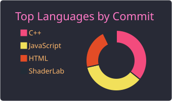
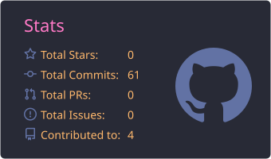

<h1 align="center">Hello 👋, I'm Nuray Bakhishli</h1>
<h3 align="center">A passionate frontend developer from Baku</h3>

<table align="center">
<tr>
<td width="50%" align="center"></td>
<td width="50%">
<ul>
<li>🌱 I’m currently learning <b>C++, Three.js and Unity Game Engine</b></li>
<li>✨ Ask me about <b>C++, HTML/CSS/SCSS, jQuery, Bootstrap, JavaScript, .NET Core, React, ExpressJS, MongoDB</b></li>
<li>⚡ Fun fact: <b>I love Japanese culture</b></li>
</ul>
</td>
</tr>
</table>

###

<h3 align="center">🛠️ Languages and Tools</h3>

  
  
  
  
  
  
  
  
  
  
  
  
  
  
  
  
  
  
  
  
  
  
  

###

<h3 align="center">🤝 Connect with me</h3>

  
  
  
  

###

<h3 align="center">📊 GitHub Stats</h3>

  
  
  

###

  

